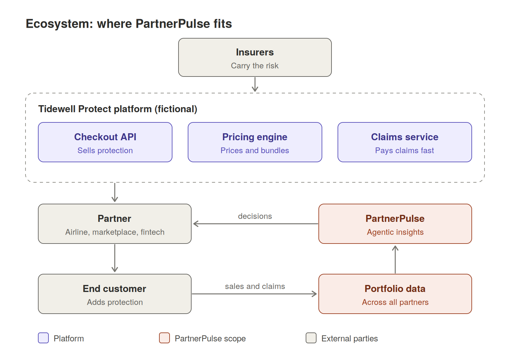
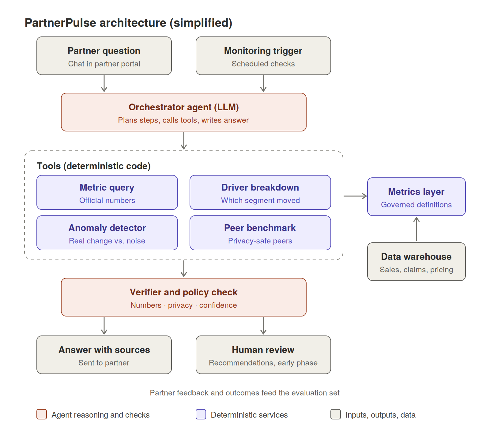
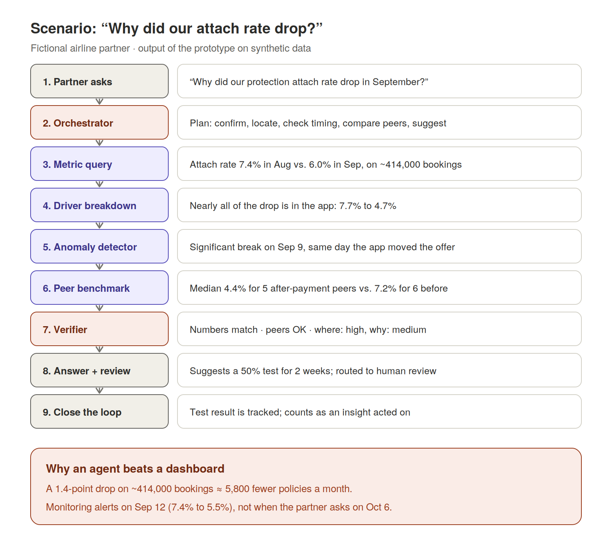

# PartnerPulse

**Agentic insights for embedded protection partners**

PartnerPulse is a product concept for an AI agent that turns a protection platform's cross-partner data into decisions its partners can act on: not another dashboard, but an analyst that answers questions, explains why metrics moved, flags problems early, and suggests what to try next.

> **Status:** Product design case study with a working Python prototype. *Tidewell Protect* is a fictional company and all data is synthetic. Not affiliated with any real company.

## Quickstart

```bash
git clone https://github.com/YOUR-USERNAME/partnerpulse.git
cd partnerpulse
pip install -e ".[dev]"

partnerpulse demo                      # monitoring alert + five partner questions
partnerpulse ask "Why did our protection attach rate drop in September?" --trace
partnerpulse monitor --as-of 2026-09-12
pytest                                 # unit tests
python evals/run_evals.py              # evaluation set against independent ground truth
```

Example output from `partnerpulse demo`:

```text
=== Monitoring on Sep 12 (3 days after the change) ===
  ALERT airline_a: Attach rate dropped from 7.4% to 5.5% starting Sep 9.

[airline_a] Q: Why did our protection attach rate drop in September?
  Your attach rate fell from 7.4% in August to 6.0% in September. Nearly all of the change comes
  from app (device), where the rate went from 7.7% to 4.7%. The shift starts on Sep 9. On the
  same day your integration logged a change: Offer placement changed from before payment to
  after payment. Among 5 similar partners offering protection after payment, the median attach
  rate is 4.4%, versus 7.2% for 6 partners offering it before payment. Suggested next step: test
  moving the app offer back before payment for 50% of users for 2 weeks.
  Confidence: where high, why medium
  [verifier: passed · routed to human review]

[airline_a] Q: What is our customer lifetime value?
  I don't have a governed metric for that yet, so I won't estimate it. I've logged the question
  for the metrics team.
```

The prototype runs fully offline with a rule-based orchestrator. An optional mode lets a Claude model plan and write the answer using the same tools and verifier: install with `pip install -e ".[llm]"`, set `ANTHROPIC_API_KEY`, and add `--llm` to `ask`. The model can be changed with the `PARTNERPULSE_MODEL` environment variable.

---

## MVP: account manager copilot

The MVP focuses on one problem: **helping account managers find out quickly why a partner's attach rate changed, and what to do about it.** It runs on a richer synthetic dataset with nine planted stories, including a price change, a market-level dip, a mix effect, gradual drift, claims lag, and decoys that must *not* trigger alerts.

```bash
partnerpulse mvp-alerts                 # insights grouped by account manager
partnerpulse mvp-data                   # write the dataset and ground truth to data/mvp/
python evals/run_mvp_stories.py         # score detection against the planted stories
```

All nine stories are detected correctly with no false alarms across five random seeds. Details: [docs/mvp-dataset.md](docs/mvp-dataset.md)

---

## The problem

Embedded protection is insurance or similar cover offered inside another company's checkout, such as trip protection when booking a flight or shipping protection on a marketplace order. A protection platform sells this cover through many digital partners, while insurers carry the financial risk.

Partners earn commission on every policy sold, so they care about one question above all: **which lever should we pull next?** Price, placement in the checkout, the bundle offered, or which markets to focus on.

Today that question is usually answered with dashboards. Dashboards show what happened but leave the partner to work out why, compare themselves with no one, and notice problems only when someone happens to look. A 1.3-point drop in attach rate can go unnoticed for weeks.

The platform, however, sees something no single partner can: patterns across **every** partner, market and product. PartnerPulse turns that into an advantage.

## Who it is for

The setup is B2B2C. The platform serves partners; partners serve their own customers.



The **primary user** is the partner's analyst or revenue manager: the person who decides how protection is priced, placed and bundled. End customers benefit indirectly through more relevant offers, and insurers benefit from a healthier book of business.

## What it does

PartnerPulse offers four capabilities, ordered from least to most trust required. This order is also the rollout order.

| Capability | What the partner gets | Example |
|---|---|---|
| **Ask** | Plain-language answers from official metrics | "What was our attach rate on Spain routes last month?" |
| **Explain** | Why a metric moved, broken down by segment | "The drop is almost all mobile, starting Sep 9." |
| **Alert** | Proactive notice when something meaningful changes | "Attach rate fell sharply in your app three days ago." |
| **Recommend** | A suggested action with evidence and confidence | "Test moving the offer before payment for 50% of users." |

## Architecture



The core design principle: **one orchestrator agent reasons and writes, while deterministic tools do all the calculating.** The LLM decides *what* to look at; tested code decides *what the numbers are*.

| Component | Role |
|---|---|
| Partner question / Monitoring trigger | Two entry points: a partner asks, or scheduled checks detect a change |
| Orchestrator agent | Plans the steps, calls tools, writes the final explanation |
| Metric query | Fetches official numbers from the metrics layer |
| Driver breakdown | Splits a change by segment and ranks which one caused it |
| Anomaly detector | Separates real changes from normal noise using statistics |
| Peer benchmark | Returns pre-computed, privacy-safe comparisons with similar partners |
| Metrics layer | Single source of governed metric definitions |
| Verifier and policy check | Confirms every number, enforces privacy rules, assigns confidence |
| Answer / Human review | Facts go straight to partners; recommendations are reviewed at first |

More detail: [docs/architecture.md](docs/architecture.md)

## Design principles

1. **The LLM never does the math.** Every number comes from the governed metrics layer, so agent answers always match official reporting.
2. **Show the work.** Every insight cites the metric, period, segment and peer group behind it.
3. **Be honest about confidence.** The agent separates "where it happened" from "why it happened," flags thin data, and says "I don't know" rather than guessing.
4. **Privacy is enforced in the data layer, not the prompt.** A partner's agent cannot technically query another partner's data.
5. **Earn autonomy gradually.** Recommendations pass human review until accuracy is proven.
6. **Measure decisions, not deliveries.** Success is insights acted on, not dashboards shipped.

## Example scenario



A partner asks why its attach rate fell. The agent confirms the drop, isolates it to the mobile app, links it to a checkout change on September 9, compares against similar partners, and suggests a test, with confidence levels stated. With monitoring switched on, the partner is alerted on September 12, three days after the change, instead of asking on October 6.

Full walkthrough with tool calls: [docs/scenario.md](docs/scenario.md)

## Success metrics

**North star: insights acted on.** The share of delivered insights that lead a partner to change something within a set time.

Supporting metrics sit in four layers: adoption, quality and trust (numeric accuracy must be 100%), action (time to detect, time to act), and business outcomes (attach-rate lift, partner revenue, partner retention). Guardrails cover privacy, loss ratio and cost.

Details and the hard part, defining "acted on": [docs/metrics-and-kpis.md](docs/metrics-and-kpis.md)

## Roadmap

| Phase | Scope | Goal |
|---|---|---|
| 1 | Ask and Explain on core sales metrics, with verifier and evaluation set | Prove accuracy and usefulness with a few pilot partners |
| 2 | Alerts from the anomaly detector | Cut time to detect problems from weeks to days |
| 3 | Recommendations with human review | Prove that suggested actions improve outcomes |
| 4 | Playbook library of past partner experiments; claims insights | Stronger evidence for recommendations; broader coverage |

## Repository contents

```
partnerpulse/
├── README.md                    Overview (this file)
├── pyproject.toml               Package and CLI definition
├── src/partnerpulse/
│   ├── data.py                  Synthetic sales data and integration change log
│   ├── metrics.py               Metrics layer: governed definitions, partner-scoped access
│   ├── tools.py                 Metric query, driver breakdown, anomaly detector, peer benchmark
│   ├── verifier.py              Number checking, leak detection, review routing
│   ├── agent.py                 Rule-based and LLM orchestrators
│   ├── monitor.py               Scheduled anomaly checks and alerts
│   └── cli.py                   Command-line interface
├── tests/                       Unit tests for each layer
├── evals/                       Evaluation set and runner
├── diagrams/                    Ecosystem, architecture and scenario diagrams (SVG + PNG)
└── docs/
    ├── architecture.md          Components, request flow, tool contracts, technical choices
    ├── scenario.md              End-to-end walkthrough of one partner question
    ├── metrics-and-kpis.md      North star, KPI layers, guardrails
    └── trust-and-privacy.md     Evaluation, verification and privacy design
```

### Where each design idea lives in code

| Design idea | Implementation |
|---|---|
| The LLM never does the math | Every number comes from `tools.py`, which reads from `metrics.py` |
| Privacy enforced in the data layer | `MetricsLayer._scoped` raises `AccessDenied` for other partners |
| Safe benchmarks | `peer_benchmark` applies a minimum peer count, a dominance rule and rounding |
| Rate vs. mix effects | `driver_breakdown` splits each segment's contribution |
| Real change vs. noise | `anomaly_detector` scans for the strongest mean shift and tests it |
| Show the work | Each tool returns `facts` and a `source`; answers list their sources |
| Verify before showing | `verifier.verify` rejects numbers not found in tool output and any other partner's name |
| Earn autonomy gradually | Answers with recommendations are flagged `requires_review` |
| Say "I don't know" | Undefined metrics are refused and logged to a metric backlog |

### Prototype limits

The data is synthetic, the question parser in offline mode understands a small set of phrasings, peer groups are by vertical and placement only, and the LLM mode is a reference implementation rather than a tuned production agent.

## Glossary

- **Attach rate:** share of eligible transactions where the customer adds protection.
- **Partner:** the digital company (airline, marketplace, fintech) offering protection in its checkout.
- **Insurer / underwriter:** the company that carries the financial risk and pays claims.
- **Loss ratio:** claims paid divided by premium earned.
- **Placement:** where and how the protection offer appears in the checkout.
- **Metrics layer (semantic layer):** a service holding the official definition and calculation of each business metric.
