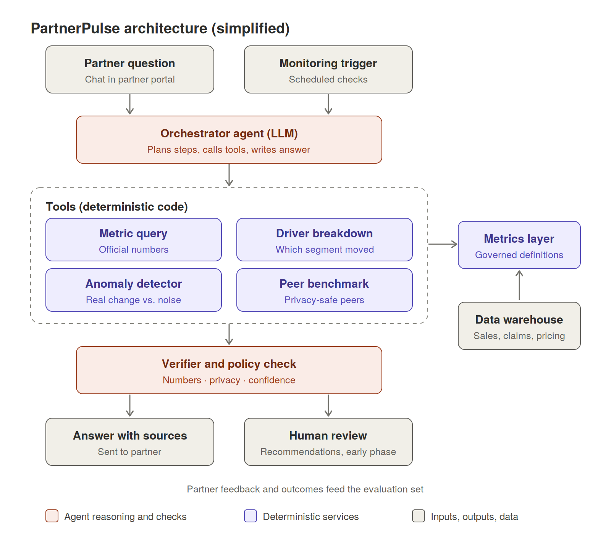
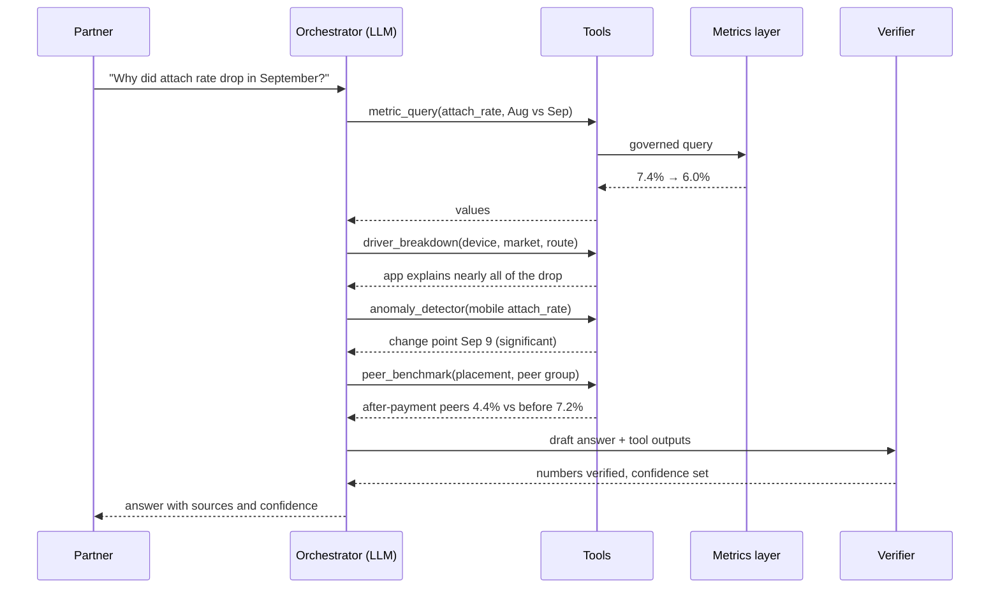

# Architecture

[← Back to README](../README.md)



## Design choice: one orchestrator, many deterministic tools

PartnerPulse uses a single LLM-based orchestrator that plans and explains, and a small set of deterministic tools that compute. This was chosen over a multi-agent design because it is simpler to test, cheaper to run, and easier to debug. Specialised agents can be added later if a clear need appears.

## Components

### Entry points
- **Partner question:** a chat panel inside the partner portal.
- **Monitoring trigger:** scheduled jobs run the anomaly detector across each partner's key metrics. When a meaningful change is found, the same agent flow runs automatically and the result is delivered as an alert.

### Orchestrator agent (LLM)
Interprets the request, builds a plan (confirm → locate → check timing → compare → suggest), calls tools in order, and writes the final answer using **only** tool outputs. It never computes figures itself.

### Tools
| Tool | Input | Output |
|---|---|---|
| `metric_query` | metric, partner, period, filters | official value(s) from the metrics layer |
| `driver_breakdown` | metric, partner, two periods, dimensions | contribution of each segment to the change, split into rate effect and mix effect |
| `anomaly_detector` | metric, partner, series | detected change points with significance |
| `peer_benchmark` | metric, partner, peer group | pre-computed peer distribution, or a refusal if privacy rules fail |

### Metrics layer
Holds governed definitions (for example, *attach rate = policies sold ÷ eligible bookings, excluding cancelled bookings*). Dashboards and the agent query the same layer, so their numbers always agree.

### Verifier and policy check
Runs after the agent drafts an answer and before anything is shown:
- every number in the text must match a tool output;
- no data from another partner may appear outside approved benchmarks;
- a confidence level is attached (high / medium / low), with separate confidence for *where* and *why*;
- answers containing recommendations are routed to human review in early phases.

## Request lifecycle



## Example tool contract (simplified from `tools.py`)

```json
{
  "name": "driver_breakdown",
  "input": {
    "metric": "attach_rate",
    "partner_id": "partner_123",
    "base_period": "2026-08",
    "compare_period": "2026-09",
    "dimensions": ["device", "market", "route_type"]
  },
  "output": {
    "total_change_pts": -1.4,
    "contributions": [
      {"segment": "device=mobile_app", "rate_effect_pts": -1.15, "mix_effect_pts": -0.02},
      {"segment": "device=desktop", "rate_effect_pts": -0.05, "mix_effect_pts": 0.00}
    ],
    "source": "metrics_layer:attach_rate:v3"
  }
}
```

Splitting each change into a **rate effect** (the segment converted worse) and a **mix effect** (traffic shifted toward a lower-converting segment) prevents misleading explanations caused by Simpson's paradox.

## Technical choices

| Approach | Use in PartnerPulse | Reason |
|---|---|---|
| Tool calling on a metrics layer | All numbers | Accurate, consistent, testable, privacy enforced centrally |
| Retrieval (RAG) | Product docs, definitions, playbooks | Good for text, not for figures |
| Text-to-SQL | Not exposed to partners | Flexible but risky: wrong joins, wrong definitions, data leakage |

**Cost and latency:** a smaller model handles simple lookups, a stronger model handles multi-step explanations, frequent questions are cached, and monitoring runs in scheduled batches.
