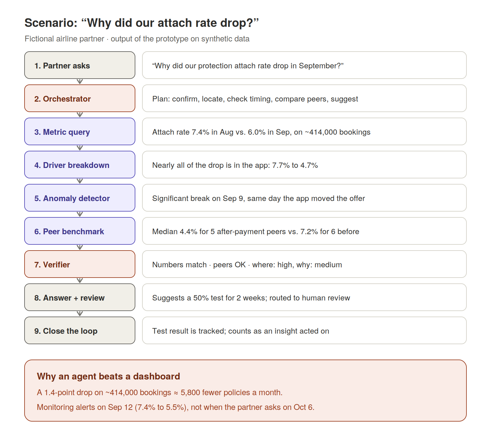

# Scenario: "Why did our attach rate drop?"

[← Back to README](../README.md)

*Fictional airline partner (`airline_a`) of the fictional Tidewell Protect platform. Numbers are the prototype's output on synthetic data. Run it yourself with `partnerpulse ask "Why did our protection attach rate drop in September?" --trace`.*

## Walkthrough

**1. The question.** On October 6 the airline's ancillary revenue manager asks: *"Why did our protection attach rate drop in September?"*

**2. Plan.** The orchestrator decides to confirm the drop, locate it, check its timing, compare with peers, and suggest an action.

**3. Confirm.** `metric_query` returns an attach rate of 7.4% in August (about 414,000 eligible bookings) and 6.0% in September.

**4. Locate.** `driver_breakdown` shows desktop and mobile web were flat; nearly all of the drop came from the app, where attach fell from 7.7% to 4.7%. The change is a rate effect, not a traffic-mix shift.

**5. Timing.** `anomaly_detector` finds a significant break on September 9, the same day the platform's integration logs show the app began requesting the protection offer *after* payment instead of before.

**6. Compare.** `peer_benchmark` shows a median attach rate of 4.4% for the 5 comparable airlines offering protection after payment, versus 7.2% for the 6 offering it before payment. Both groups pass the minimum-peer and dominance rules.

**7. Verify.** The verifier confirms every number matches tool output and that the peer group is large enough. Confidence: **high** on where and when the drop happened; **medium** on the cause, because the timing is strong evidence but the cause has not been tested.

**8. Answer.** Because it contains a recommendation, an account manager reviews the answer before it is sent:

> Your attach rate fell from 7.4% in August to 6.0% in September. Nearly all of the change comes from app (device), where the rate went from 7.7% to 4.7%. The shift starts on Sep 9. On the same day your integration logged a change: Offer placement changed from before payment to after payment. Among 5 similar partners offering protection after payment, the median attach rate is 4.4%, versus 7.2% for 6 partners offering it before payment. Suggested next step: test moving the app offer back before payment for 50% of users for 2 weeks.
>
> *Confidence: where high, why medium*
> *Sources: metrics:attach_rate:v3, 2026-08 vs 2026-09; driver breakdown by device; change-point analysis (app); peer benchmark, airline*
> *[verifier: passed · routed to human review]*

**9. Close the loop.** The partner runs the test. Its result is recorded, the insight counts as **acted on**, and the evidence strengthens future recommendations for other partners.

## Why it matters

A 1.4-point drop on roughly 414,000 monthly bookings is about **5,800 fewer policies a month**. In this story the partner asks on October 6. With monitoring enabled (`partnerpulse monitor --as-of 2026-09-12`), the anomaly detector raises an alert on September 12, three days after the change, recovering about three weeks of lost revenue.

**A dashboard waits to be looked at. An agent tells you.**
